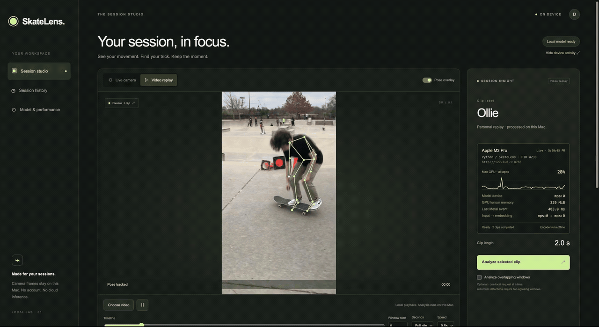

# SkateLens



A local skateboarding studio with video replay, live camera, pose tracking, and VideoMAE inference on Apple silicon. The recorded UI demo shows Daniel’s skate clip alongside live M3 Pro activity.

[Watch the demo](https://github.com/danielsuhcompsci/skatelens/raw/refs/heads/main/docs/demo.mp4)

## Run

Python 3.12 and Kaggle access to `dsuhcs/skateboardml-img3115-inference` are required.

```sh
git clone https://github.com/danielsuhcompsci/skatelens.git
cd skatelens
./setup.sh
./run.sh
```

Open **http://127.0.0.1:8765**. Choose a video or start the camera; open **Device activity** for live GPU readings.

[Model details](docs/model-card.md) · [Component credits](web/design-resources/ATTRIBUTION.md) · [MIT license](LICENSE)
