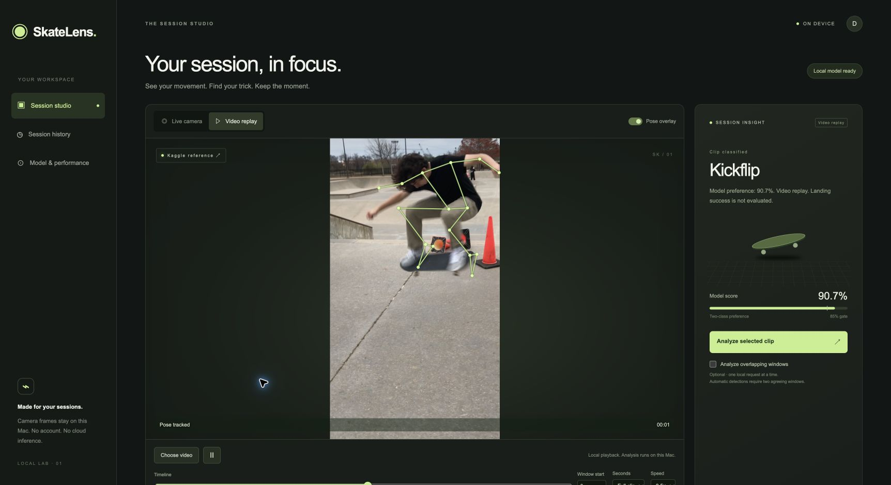
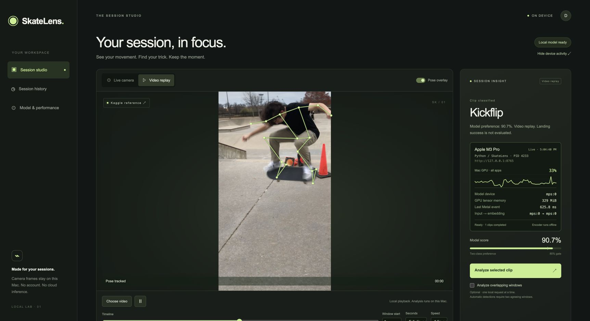

# SkateLens

A local skateboarding session studio. Replay a clip or start a camera, see a live pose overlay, and classify **ollies** and **kickflips** with VideoMAE.

[](https://github.com/danielsuhcompsci/skatelens/raw/refs/heads/main/docs/demo.mp4)

**[Watch the demo](https://github.com/danielsuhcompsci/skatelens/raw/refs/heads/main/docs/demo.mp4)** · A real clip of Daniel, played in the app with its local model result.

## What it does

- Live camera and video replay, with a MediaPipe pose overlay.
- Select a clip window, scrub the timeline, and replay at half speed.
- Run a frozen VideoMAE encoder and linear classifier on your own machine.
- Keep accepted detections in a session reel and export results as JSON.
- Optionally analyze overlapping windows, with visibility, movement, agreement, and duplicate gates.

The interface uses the original dark-and-green SkateLens design. Its animated source tabs adapt Animata Fluid Tabs, discovered through Designeer; [source and license credits](web/design-resources/ATTRIBUTION.md) are included.

## Local GPU proof

[](https://github.com/danielsuhcompsci/skatelens/raw/refs/heads/main/docs/local-gpu.mp4)

**[Watch local inference with live GPU readings](https://github.com/danielsuhcompsci/skatelens/raw/refs/heads/main/docs/local-gpu.mp4)** · [Recorded measurements](docs/local-gpu.json)

Open **Device activity** to see the local Python process, loopback address, actual model/input/embedding device, GPU tensor memory, and the last timed Metal event. The recording shows VideoMAE running on an **Apple M3 Pro**, with tensors on **`mps:0`**, **329 MiB** of GPU tensor memory, and a **625.8 ms** Metal event for the kickflip clip.

The graph reads macOS’s `IOAccelerator` device utilization counter and covers **all apps on the Mac**. The tensor placement, memory, and Metal event readings come from the SkateLens Python process. The model encoder runs on the GPU; video decoding, preprocessing, the small linear probe, and browser pose tracking use the CPU. Example footage streams before inference; the encoder loads local weights in offline mode.

The monitor uses [PyTorch’s MPS event timing](https://docs.pytorch.org/docs/stable/generated/torch.mps.event.Event.html) and [GPU tensor memory readings](https://docs.pytorch.org/docs/stable/generated/torch.mps.current_allocated_memory.html). It requires no administrator access. Missing counters display as unavailable.

## Run locally

Tested with Python 3.12 on macOS with Apple silicon. Apple GPU inference is selected automatically; CPU inference is also supported. Node.js is only needed to run the JavaScript tests.

The current classifier is stored in the private Kaggle notebook `dsuhcs/skateboardml-img3115-inference`. Setup requires Kaggle credentials with access to that notebook. The public repository contains the application and pinned artifact hashes; it does not distribute model weights or the training dataset.

```sh
git clone https://github.com/danielsuhcompsci/skatelens.git
cd skatelens
./setup.sh
./run.sh
```

Open **http://127.0.0.1:8765** in Chrome. Setup creates a Python environment and downloads the pinned encoder, classifier, pose model, and browser runtime. It uses `uv` when available, otherwise Python’s built-in virtual environment and pip.

For CPU inference:

```sh
SKATELENS_DEVICE=cpu ./run.sh
```

## Try a session

Choose **Video replay → Choose video**, select a short clip, set the window start and length, then press **Analyze selected clip**. Accepted results appear below the player. **Replay clip** returns to that moment, and **Export results** saves the session’s scores and timings.

For the camera, select **Live camera → Start camera** and keep your full body in view. Camera analysis uses the latest two seconds. **Stop camera** releases the camera and its frame buffer. Automatic analysis is off by default.

The example buttons stream existing clips for playback. Personal examples require access to Daniel’s Kaggle assets.

## Model and data

The classifier distinguishes two classes; the displayed score is an uncalibrated preference between them. “Unknown” is an acceptance-rule outcome, not a trained third class. SkateLens does not judge whether a trick landed successfully.

Inference runs locally. The server binds to loopback, processes media in memory, and saves only small score/timing reports. Camera frames, replay videos, and extracted features are not written by the application. Session exports contain results, source names, and timings, not media. The short demo above is a separately published screen recording.

See the [model card](docs/model-card.md) for preprocessing, model provenance, and acceptance rules.

## Development

The UI is plain HTML, CSS, and JavaScript. FastAPI serves it and performs local PyTorch inference; no frontend build step is needed.

```text
web/                 Interface, pose worker, and event gates
server.py            Local API and memory-only replay decoding
inference.py         VideoMAE preprocessing and classification
runtime_monitor.py   Read-only macOS GPU counters
model-config.json    Pinned model recipe and class mapping
config/              Artifact hashes and browser-runtime manifest
tests/               Event-gate and service checks
docs/                Demo and model documentation
```

With the server running:

```sh
node --test tests/gate.test.mjs
.venv/bin/python tests/runtime_monitor_test.py
.venv/bin/python tests/service_checks.py
```

The in-app **Model, controls & performance** panel also runs four real example clips. These are training-source functionality checks, not held-out accuracy measurements.

## License

Application code: [MIT](LICENSE). Reused component code retains its upstream MIT notice. Model and dataset terms belong to their respective publishers; the demo footage belongs to Daniel Suh.
